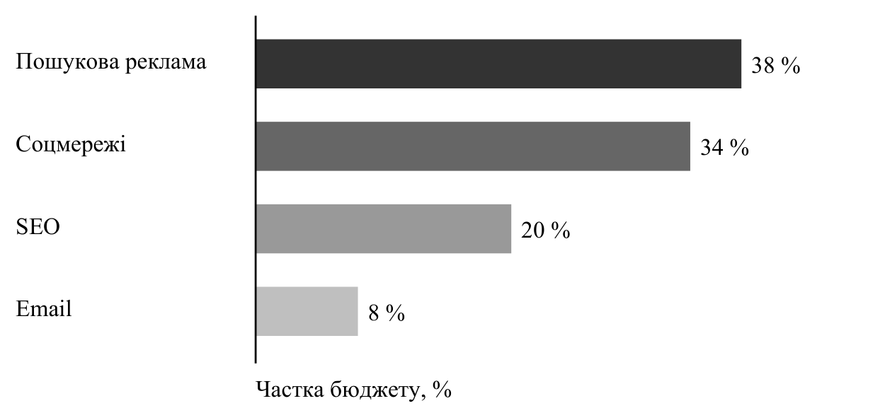

---
# ДЕМО ДЛЯ ПЕРЕВІРКИ ВЕРСТКИ. Підприємство «Приклад» і всі його цифри вигадані. Не використовувати як зразок змісту.
variant: A
kafedra: Кафедра маркетингу
dyscyplina: Маркетинг
tema: Оцінка ефективності цифрових рекламних каналів підприємства та напрями її підвищення
baza: ТОВ «Приклад», м. Київ
kurs: 2
hrupa: 
fakultet: торгівлі та маркетингу
specialnist: D5 Маркетинг
prohrama: Маркетинг
student: Демо Студент Студентович
stat: студента
kerivnyk: 
misto: Київ
rik: 2026
sources_order: alpha
cite_sep: ";"
---

# ВСТУП

**Актуальність теми.** Цифрові канали стали основним способом залучення клієнтів для малого бізнесу в Україні: за даними щорічного звіту DataReportal, більшість населення країни користується інтернетом щодня [@datareportal2025]. Водночас реклама в цифровому середовищі регулюється тими самими нормами, що й традиційна, зокрема Законом України «Про рекламу» [@zakon_reklama]. Це посилює потребу в систематичній оцінці ефективності каналів.

**Мета роботи** полягає в обґрунтуванні теоретичних положень і розробці практичних рекомендацій щодо підвищення ефективності цифрових рекламних каналів ТОВ «Приклад».

Для досягнення мети поставлено такі завдання:
- розкрити сутність цифрових рекламних каналів і систематизувати показники їх ефективності;
- проаналізувати основні показники діяльності ТОВ «Приклад»;
- оцінити ефективність рекламних каналів підприємства;
- розробити рекомендації щодо перерозподілу рекламного бюджету.

**Об'єктом дослідження** є процес управління рекламною діяльністю підприємства.

**Предметом дослідження** є методичні та практичні засади оцінки ефективності цифрових рекламних каналів ТОВ «Приклад».

Емпіричною базою дослідження є ТОВ «Приклад» (м. Київ), демонстраційне підприємство.

Методи дослідження: аналіз і синтез (для систематизації підходів), порівняльний аналіз (для оцінки каналів), графічний і табличний методи (для наочного подання результатів).

Інформаційну базу дослідження становлять закони України, стандарти, дані DataReportal і внутрішні дані підприємства. Практичне значення одержаних результатів полягає в можливості використання рекомендацій для планування бюджету ТОВ «Приклад».

Структура роботи. Курсова робота складається зі вступу, чотирьох пунктів, висновків та пропозицій, списку використаних джерел ({{N_DZHEREL}} найменувань) і {{N_DOD}} додатка. Обсяг основного тексту становить {{N_STOR}} сторінок, робота містить {{N_TABL}} таблиці і {{N_RYS}} рисунок.

# 1. ТЕОРЕТИЧНІ ЗАСАДИ ОЦІНКИ ЕФЕКТИВНОСТІ ЦИФРОВИХ РЕКЛАМНИХ КАНАЛІВ

Оцінка ефективності реклами спирається на систему показників, що пов'язують витрати з результатами на кожному етапі воронки (табл. 1). Оформлення джерел у роботі відповідає ДСТУ 8302:2015 [@dstu8302].

Таблиця 1: Основні показники ефективності цифрових рекламних каналів
| Показник | Формула | Що показує |
|---|---|---|
| CTR | кліки / покази × 100 % | привабливість оголошення |
| CPC | витрати / кліки | вартість залучення відвідувача |
| CPA | витрати / конверсії | вартість заявки |
Джерело: систематизовано автором.

Отже, ефективність каналу доцільно оцінювати не одним показником, а системою, що охоплює всі етапи шляху клієнта. Саме такий підхід застосовано в наступних пунктах.

# 2. АНАЛІЗ ДІЯЛЬНОСТІ ТОВ «ПРИКЛАД»

Структуру рекламного бюджету підприємства подано на рис. 1. Найбільшу частку займає пошукова реклама, що відповідає характеру попиту на послуги підприємства. Діяльність підприємства щодо збору даних клієнтів відбувається з урахуванням Закону України «Про захист персональних даних» [@zakon_pd].

{w=14}
Джерело: розроблено автором за демо-даними.

Отже, бюджет підприємства зосереджений у двох каналах, тому оцінка їх віддачі є ключовою для подальших рекомендацій.

# 3. ОЦІНКА ЕФЕКТИВНОСТІ РЕКЛАМНИХ КАНАЛІВ ТОВ «ПРИКЛАД»

Окупність маркетингових витрат розраховано за формулою (1):

$$ ROMI = (Д − В) / В × 100 % $$ (1)
де Д - дохід, отриманий завдяки маркетинговим заходам, грн;
В - витрати на маркетингові заходи, грн.

Результати розрахунку наведено в табл. 2.

Таблиця 2: Окупність рекламних каналів ТОВ «Приклад» (демо-дані)
| Канал | Витрати, тис. грн | Дохід, тис. грн | ROMI, % |
|---|---|---|---|
| Пошукова реклама | 38,0 | 152,0 | 300,0 |
| Соцмережі | 34,0 | 61,2 | 80,0 |
Джерело: розраховано автором за демо-даними.

Отже, пошукова реклама окуповується майже вчетверо краще за соцмережі, що є підставою для перерозподілу бюджету.

# 4. НАПРЯМИ ПІДВИЩЕННЯ ЕФЕКТИВНОСТІ РЕКЛАМНИХ КАНАЛІВ

Перерозподіл бюджету має враховувати вимоги до інформації для споживачів, визначені Законом України «Про захист прав споживачів» [@zakon_spozh], і правила електронної торгівлі [@zakon_ecom].

Таким чином, запропоновані заходи спрямовані на зростання окупності без збільшення загального бюджету.

# ВИСНОВКИ ТА ПРОПОЗИЦІЇ

1. Систематизовано показники ефективності цифрових каналів.
2. Встановлено, що пошукова реклама має найвищу окупність.

# СПИСОК ВИКОРИСТАНИХ ДЖЕРЕЛ

[@zakon_reklama] Про рекламу : Закон України від 03.07.1996 № 270/96-ВР. URL: https://zakon.rada.gov.ua/laws/show/270/96-вр (дата звернення: 27.10.2026).
[@zakon_spozh] Про захист прав споживачів : Закон України від 12.05.1991 № 1023-XII. URL: https://zakon.rada.gov.ua/laws/show/1023-12 (дата звернення: 27.10.2026).
[@zakon_ecom] Про електронну комерцію : Закон України від 03.09.2015 № 675-VIII. URL: https://zakon.rada.gov.ua/laws/show/675-19 (дата звернення: 27.10.2026).
[@zakon_pd] Про захист персональних даних : Закон України від 01.06.2010 № 2297-VI. URL: https://zakon.rada.gov.ua/laws/show/2297-17 (дата звернення: 27.10.2026).
[@dstu8302] ДСТУ 8302:2015. Інформація та документація. Бібліографічне посилання. Загальні положення та правила складання. [Чинний від 2016-07-01]. Вид. офіц. Київ : ДП «УкрНДНЦ», 2016. 16 с.
[@datareportal2025] Digital 2025: Ukraine. DataReportal. URL: https://datareportal.com/reports/digital-2025-ukraine (accessed: 27.10.2026).

# ДОДАТКИ

## Додаток А

### Анкета опитування клієнтів (демо)

1) Як ви дізналися про компанію?
